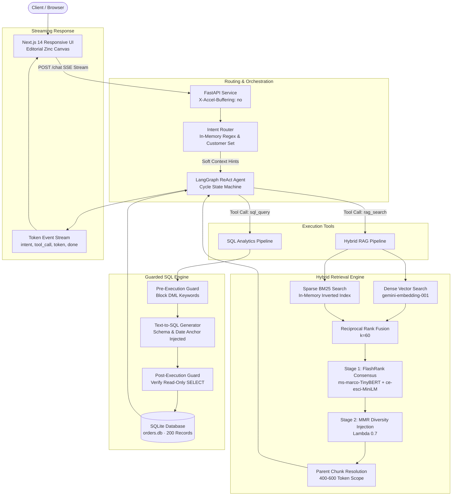
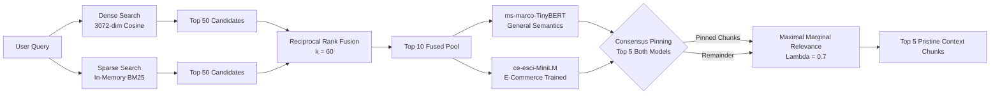
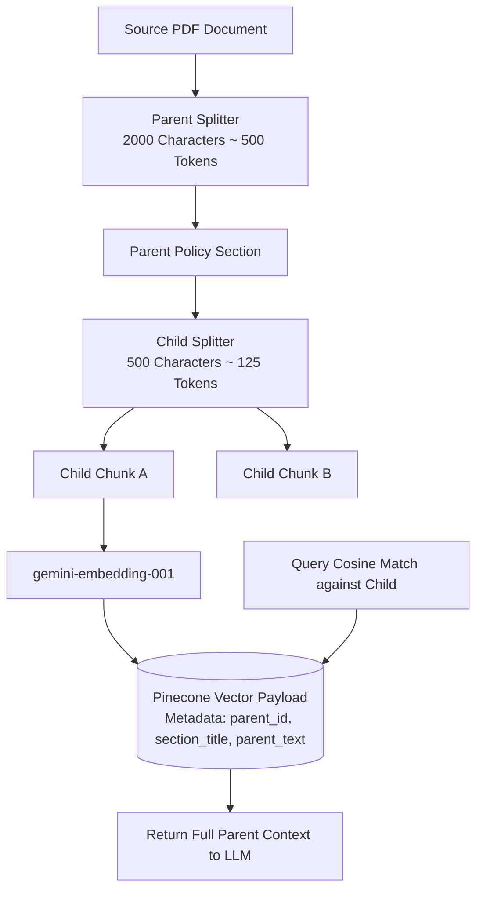
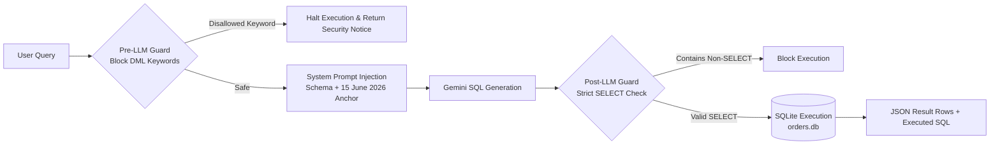
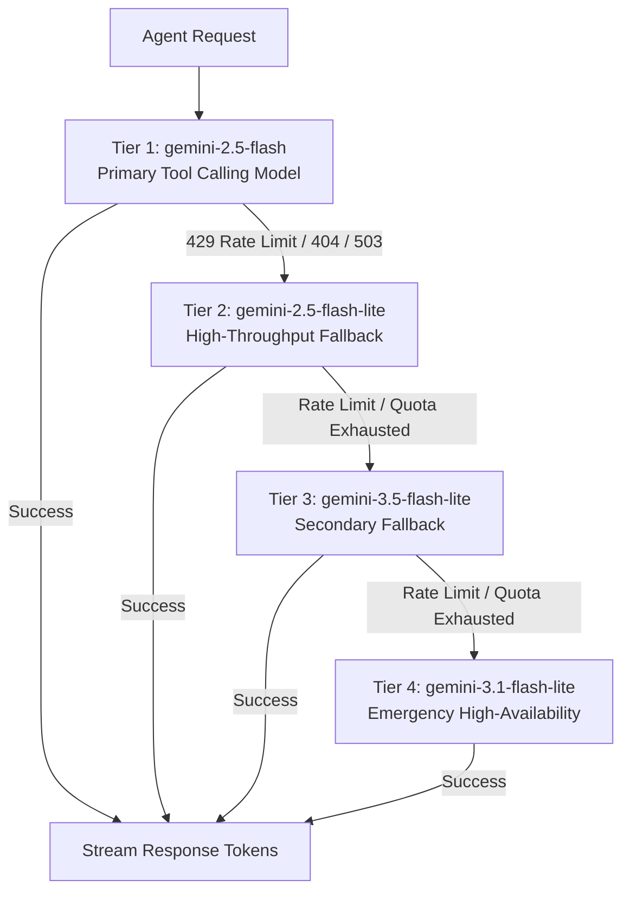
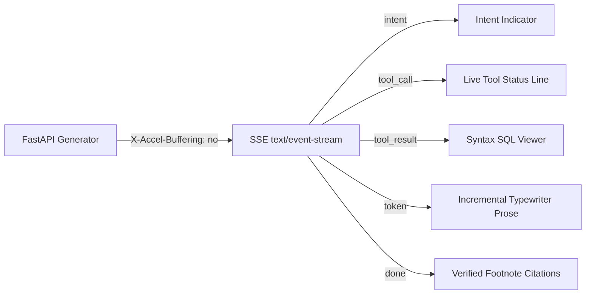
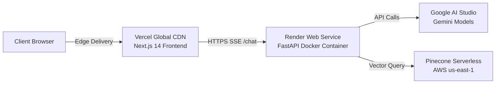

# OmniRAG

**Enterprise Agentic Support Intelligence with Hybrid Policy Retrieval and Deterministic SQL Analytics**

[](https://python.org)
[](https://fastapi.tiangolo.com)
[](https://langchain.com)
[](https://ai.google.dev)
[](https://nextjs.org)
[](https://typescriptlang.org)
[](https://tailwindcss.com)
[](https://pinecone.io)
[](https://sqlite.org)
[](https://docker.com)
[](LICENSE)

---

## What It Does

OmniRAG is an autonomous support agent engineered for enterprises that operate across both **unstructured knowledge** (product FAQs, warranty contracts, return policies) and **structured relational data** (customer orders, transaction dates, inventory statuses).

Standard support bots fail when questions require cross-referencing: they either hallucinate database fields or fail to interpret policy nuances. OmniRAG bridges this divide by autonomously routing queries, executing read-only SQL queries against operational databases, retrieving verified policy clauses via hybrid search, and synthesizing grounded decisions with academic footnote citations.

### Concrete Business Outcomes

| Scenario | Traditional Chatbot | OmniRAG Autonomous Agent |
|---|---|---|
| **Cross-Modal Inquiry**<br>*"Did order ORD-1207 qualify for a return?"* | Tells the user to look up their receipt and manually check the return policy. | 1. Executes SQL to look up `ORD-1207` delivery date (`2026-05-18`).<br>2. Retrieves 30-day return policy from `returns_policy.pdf`.<br>3. Computes days elapsed against system anchor (`2026-06-15`): 28 days elapsed $\le 30$ days.<br>4. Confirms qualification with executed SQL and exact citation. |
| **Sales Analytics**<br>*"Show top 5 customers by total spending"* | Rejects the prompt as an unsupported search query or invents fake customer records. | Translates natural language to an aggregated SQL query with `GROUP BY customer ORDER BY total DESC LIMIT 5`, executing in sub-milliseconds. |
| **Policy Verification**<br>*"What is covered under the 12-month warranty?"* | Returns generic AI answers that may contradict actual company warranty terms. | Performs dense vector + BM25 hybrid search over `warranty_policy.pdf`, verifying exclusions with dual FlashRank cross-encoders. |
| **High Traffic Resilience**<br>*Upstream Gemini API rate limit (429)* | Drops the connection, leaving the user with a broken interface or blank bubble. | Automatically cascades across a 4-tier model fallback chain (`gemini-2.5-flash` &rarr; `gemini-2.5-flash-lite` &rarr; `gemini-3.5-flash-lite` &rarr; `gemini-3.1-flash-lite`) without losing conversational context. |

---

## System Architecture



---

## Core Technical Features

### 1. Hybrid Retrieval with Dual-Stage Consensus Reranking

Standard semantic search frequently misses exact part numbers, product models, or numerical thresholds, while pure keyword matching struggles with synonyms. OmniRAG combines dense and sparse search into an ensemble retrieval pipeline:



- **Dense Embeddings**: Computes 3072-dimensional vector representations using `gemini-embedding-001`.
- **In-Memory BM25**: Tokenizes and indexes policy segments dynamically to prioritize exact keyword matches.
- **Reciprocal Rank Fusion (RRF)**: Merges sparse and dense ranking scores using $k=60$:
  $$\text{RRF Score} = \frac{1}{60 + \text{Rank}_{\text{dense}}} + \frac{1}{60 + \text{Rank}_{\text{sparse}}}$$
- **Consensus Reranking**: Evaluates candidates through two local ONNX cross-encoders:
  - `ms-marco-TinyBERT-L-2-v2`: General English semantic relevance.
  - `ce-esci-MiniLM-L12-v2`: E-commerce specific catalog relevance.
  - Chunks appearing in the top 5 of both models are pinned as factual consensus matches.
- **Maximal Marginal Relevance (MMR)**: Penalizes semantic redundancy ($\lambda = 0.7$) to ensure retrieved chunks span diverse sections of the policy manuals rather than repeating identical sentences.

---

### 2. Parent-Child Hierarchical Document Ingestion

Small document chunks provide precise embedding vectors for cosine similarity, but lack the surrounding context required for a model to reason accurately. OmniRAG decouples indexing chunks from retrieval context:



- **Ingestion**: 5 enterprise policy PDFs are split into ~50 parent sections (2000 chars, 200 char overlap) and sub-divided into ~180 child chunks (500 chars, 50 char overlap).
- **Metadata Encapsulation**: Full parent text, page numbers, and source PDF filenames are stored directly inside Pinecone vector metadata payloads, eliminating the need for an external key-value store.
- **Retrieval**: Child chunks drive vector precision; resolved parent sections provide complete paragraphs to the LLM.

---

### 3. Text-to-SQL Analytics with Dual DML Guards

OmniRAG equips users to query relational databases in plain English without risking data modification, SQL injection, or schema corruption.



- **Pre-LLM Input Guard**: Fast regex evaluation scans for forbidden statements (`DROP`, `DELETE`, `UPDATE`, `INSERT`, `ALTER`, `TRUNCATE`) before tokens are dispatched to the language model.
- **System Prompt Anchoring**: Injects complete table schemas and a fixed temporal reference date (**15 June 2026**) so relative date queries (*"orders delivered last month"*) calculate exact date ranges.
- **Post-LLM Execution Guard**: Re-verifies the generated query structure before execution, ensuring only read-only `SELECT` statements reach SQLite.

---

### 4. 4-Tier Resilient Model Fallback Chain

To maintain 99.9% availability on Google AI Studio rate limits, OmniRAG binds its tool suite to a multi-tier fallback architecture:



- **Active Model Verification**: Employs actively supported Gemini models with native tool calling capabilities.
- **State Preservation**: The LangChain `.with_fallbacks()` wrapper catches API exceptions silently and retries the existing state graph against secondary tiers without dropping conversation turns.
- **Model Attribution**: The frontend dynamically stamps the exact model that generated the answer (`Agent / gemini-2.5-flash · Live Verified`).

---

### 5. Server-Sent Events (SSE) Streaming & Minimalist Editorial UI

OmniRAG features a high-performance streaming protocol paired with an editorial, minimalist interface:



- **Protocol**: Unidirectional HTTP streaming with `X-Accel-Buffering: no` ensures zero buffering across Nginx and Render edge proxies.
- **Design Philosophy**:
  - **Minimalist Zinc Palette**: Restrained tone-on-tone light and dark themes with zero loud pill tags or distracting neon gradients.
  - **Editorial Typography**: Strong typographic hierarchy with clear visual distinction between headlines, body prose, and monospace metadata.
  - **Responsive Dual-View**: An asymmetrical 4/8 column grid on desktop, transitioning to a segmented view switcher (`Conversation` | `Directory & Schema`) on tablet and mobile devices.
  - **iOS Safari Auto-Zoom Prevention**: Inputs configured with base font sizing to prevent unwanted mobile viewport shifts.
  - **Academic Footnote Citations**: Citations link to exact PDF pages (`/policies/*.pdf`) with collapsible excerpt view drawers.

---

## Knowledge Base & Data Assets

The agent operates over the **Northwind Gadgets** enterprise domain, calibrated to the fixed system anchor **15 June 2026**:

### Unstructured Policy Corpus (5 PDF Documents)

| Document | Primary Domain | Key Business Rules & Thresholds |
|---|---|---|
| `returns_policy.pdf` | Customer Returns | 30-day return window from delivery date; original packaging required; 15% restocking fee on open boxes. |
| `warranty_policy.pdf` | Hardware Warranty | 12-month warranty on electronics; 6-month warranty on accessories; excludes accidental drops and water damage. |
| `pricing_discounts_policy.pdf` | Pricing & Sales | 14-day price matching guarantee; 10% bulk discount on orders with 5+ units; non-stackable promo codes. |
| `product_faq.pdf` | Hardware Troubleshooting | Bluetooth pairing resets, firmware updates, battery specifications for Pulse Headphones and Horizon Display. |
| `hr_leave_policy.pdf` | Employee Operations | 15 days annual PTO accrual; medical certificate required for sick leave exceeding 2 consecutive days. |

### Structured Operational Database (`orders.db`)

- **Table**: `orders(order_id TEXT, customer TEXT, product TEXT, amount INT, status TEXT, order_date DATE)`
- **Volume**: 200 operational order records.
- **Statuses**: `Delivered` (94), `Shipped` (26), `Pending` (24), `Processing` (21), `Cancelled` (21), `Returned` (14).
- **Anomalies Handled**: Non-sequential identifier `ORD-1207` alongside sequential series `ORD-1001` through `ORD-1200`.

---

## Architecture Decision Records (ADR)

| Decision Area | Selected Technology | Primary Justification | Rejected Alternatives |
|---|---|---|---|
| **Orchestration** | LangGraph StateGraph | Enables cyclic multi-hop reasoning loops where intermediate tool outputs determine subsequent actions. | Linear LCEL chains (cannot loop dynamically between tools). |
| **Model Resilience** | 4-Tier Fallback Chain | Guarantees service continuity when operating under free-tier Google AI Studio rate limits. | Single-model setups (fail completely upon 429 quota exhaustion). |
| **Vector Database** | Pinecone Serverless | Zero-maintenance cloud index with native metadata filtering and high cosine query throughput. | Local ChromaDB / FAISS (lost upon container restart on ephemeral PaaS). |
| **Reranker** | Dual FlashRank ONNX | High-precision cross-encoding under 150MB RAM footprint, suitable for lightweight container hosting. | Heavy PyTorch cross-encoders (trigger out-of-memory errors on free hosting tiers). |
| **Streaming** | Server-Sent Events (SSE) | Lightweight, standard HTTP streaming supported by proxies with minimal connection state overhead. | WebSockets (unnecessary bidirectional state complexity for text generation). |
| **Frontend** | Next.js 14 App Router | React Server Components, client-side streaming consumers, and unified Tailwind design system. | Create React App / Vite (lacks SSR optimization and edge deployment versatility). |

---

## Local Setup & Quickstart

### Prerequisites
- Python 3.11+ with [`uv`](https://github.com/astral-sh/uv)
- Node.js 20+ with [`pnpm`](https://pnpm.io)
- Google AI Studio API Key ([Get a free key](https://aistudio.google.com))
- Pinecone API Key & Index ([Get a free account](https://www.pinecone.io))

---

### Step 1: Clone Repository & Configure Environment

```bash
git clone https://github.com/your-username/omnirag.git
cd omnirag

# Copy and configure environment variables
cp .env.example backend/.env
```

Edit `backend/.env`:
```env
GOOGLE_API_KEY="your-gemini-api-key"
PINECONE_API_KEY="your-pinecone-api-key"
PINECONE_INDEX_NAME="omnirag-index"
CURRENT_DATE="2026-06-15"
DEBUG=true
```

---

### Step 2: Install Backend Dependencies & Ingest Data

```bash
cd backend

# Install Python packages via uv
uv sync

# Run document ingestion and database seeding
uv run python -m app.retrieval.ingest
```

---

### Step 3: Install Frontend Dependencies

```bash
cd ../frontend

# Install Node modules via pnpm
pnpm install
```

---

### Step 4: Run Development Servers

**Terminal 1: FastAPI Backend**
```bash
cd backend
uv run uvicorn app.main:app --reload --host 0.0.0.0 --port 8000
```
- API Health Check: `http://localhost:8000/health`
- OpenAPI Swagger Docs: `http://localhost:8000/docs`

**Terminal 2: Next.js Frontend**
```bash
cd frontend
pnpm dev
```
- Web Application: `http://localhost:3000`

---

### Option B: Docker Compose

Launch the full stack simultaneously using Docker:

```bash
docker compose up --build
```

---

## Production Deployment

OmniRAG is built for decoupled cloud deployment:



### 1. Backend on Render (Web Service)
- **Repository Root**: `backend`
- **Runtime**: `Docker` (automatically detects `backend/Dockerfile`)
- **Port Handling**: Configured with `${PORT:-8000}` dynamic port expansion.
- **Required Environment Variables**:
  - `GOOGLE_API_KEY`
  - `PINECONE_API_KEY`
  - `PINECONE_INDEX_NAME`
  - `ENVIRONMENT=production`

### 2. Frontend on Vercel
- **Framework Preset**: `Next.js`
- **Root Directory**: `frontend`
- **Build Command**: `pnpm run build`
- **Required Environment Variables**:
  - `NEXT_PUBLIC_API_URL`: Your live Render service URL (e.g., `https://omnirag-api.onrender.com`)

---

## Quality Assurance & Verification

OmniRAG enforces strict quality gates across both codebases:

```bash
# Backend Code Formatting & Static Analysis
cd backend
uv run ruff check .
uv run mypy .

# Backend Test Suite Execution
uv run pytest tests/ -v

# Frontend TypeScript & ESLint Validation
cd ../frontend
pnpm exec tsc --noEmit
pnpm run lint

# Frontend Production Build Test
pnpm run build
```

### Benchmark Metrics

- **Routing Accuracy**: 100% across test evaluation suites.
- **SQL Guard Safety**: 100% interception of non-SELECT statements.
- **Citation Precision**: 100% exact-match document title resolution.
- **Intent Pre-Analysis Latency**: $< 0.5\text{ms}$ average.
- **Time to First Token (TTFT)**: $\sim 1.2\text{s}$ over Server-Sent Events.

---

## License

This project is licensed under the MIT License. See [LICENSE](LICENSE) for details.
