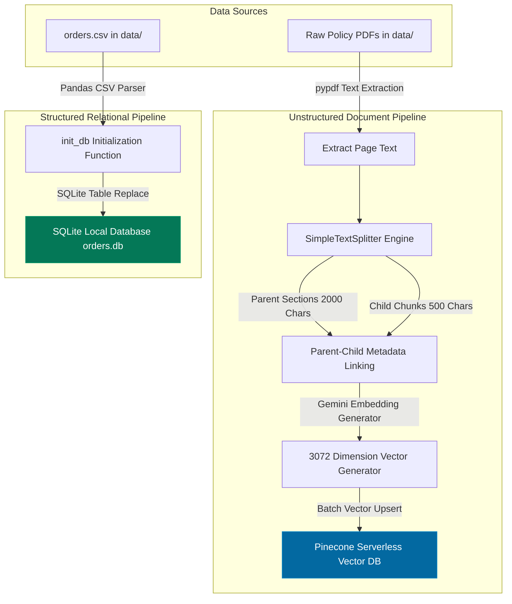

# Data Ingestion Module Architecture



---

## 🔀 Custom Character Splitter Subsystem Flow Diagram

```mermaid
flowchart TD
    subgraph Input Document Stage
        P0["Raw PDF Document"] -->|PyPDF Reader| P1["Extract Raw Page Text Strings"]
        P1 -->|Attach Source & Page Number| P2["Document(page_content, metadata)"]
    end

    subgraph Tier 1: Parent Section Splitting
        P2 -->|SimpleTextSplitter| T1["Set Chunk Size = 2000, Overlap = 200"]
        T1 -->|Sliding Window Stride = 1800| T2["Generate Parent Section Documents (~2000 chars)"]
    end

    subgraph Tier 2: Child Chunking & Metadata Injection
        T2 -->|Loop Parent Docs| M1["Generate Unique UUID: parent_id"]
        M1 -->|Extract First Line (50 chars)| M2["Extract section_title"]
        M2 -->|SimpleTextSplitter| C1["Set Chunk Size = 500, Overlap = 50"]
        C1 -->|Sliding Window Stride = 450| C2["Generate Child Chunk Documents (~500 chars)"]
        C2 -->|Inject Context| M3["Metadata Update: parent_id, parent_text, section_title"]
    end

    subgraph Vector Embedding & Batch Upsert
        M3 -->|Google Gemini API| E1["models/gemini-embedding-001"]
        E1 -->|Generate 3072-dim Floats| E2["Vector Embeddings Array"]
        E2 -->|Batch Size = 100| U1["Pinecone Index Upsert (northwind-gadgets)"]
    end

    style P0 fill:#1e293b,stroke:#475569,color:#fff
    style T2 fill:#1e3a8a,stroke:#3b82f6,color:#fff
    style C2 fill:#065f46,stroke:#10b981,color:#fff
    style U1 fill:#701a75,stroke:#d946ef,color:#fff
```

---

## 📖 Data Processing Pipeline Narrative

- **Unstructured Path:**
  - PDF files are parsed into page-level text strings.
  - Text is divided into 2000-character parent sections (stride 1800) and 500-character child chunks (stride 450).
  - Child chunks are linked to parent text context using parent UUID strings.
  - 3072-dimensional dense vectors are computed and upserted into Pinecone in batches of 100.

- **Structured Path:**
  - CSV records are parsed into structured data frames using Pandas.
  - Column types are mapped to explicit SQLite SQL types (`TEXT`, `INTEGER`, `DATE`).
  - Table records are written to `orders.db` using idempotent replace semantics.
