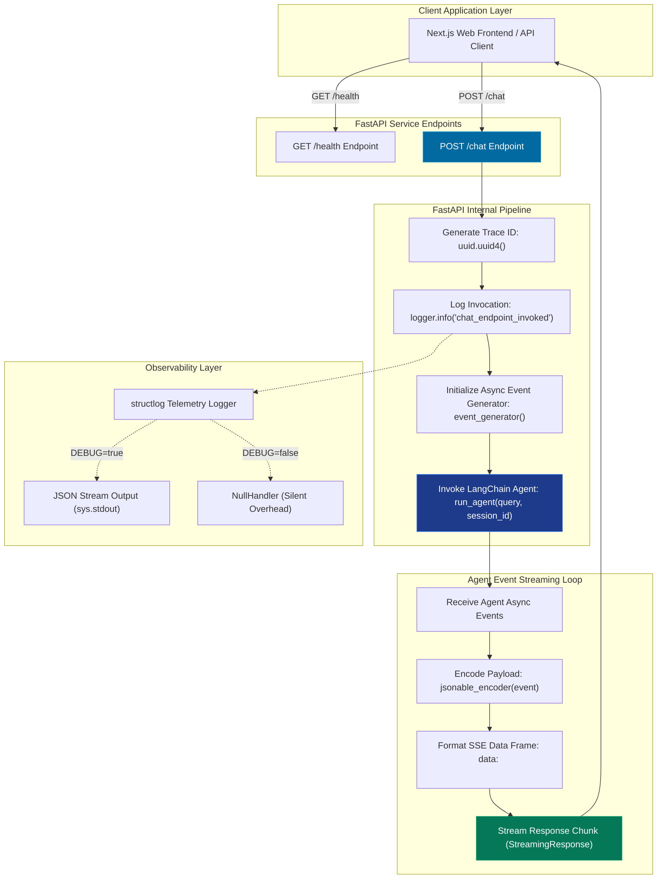
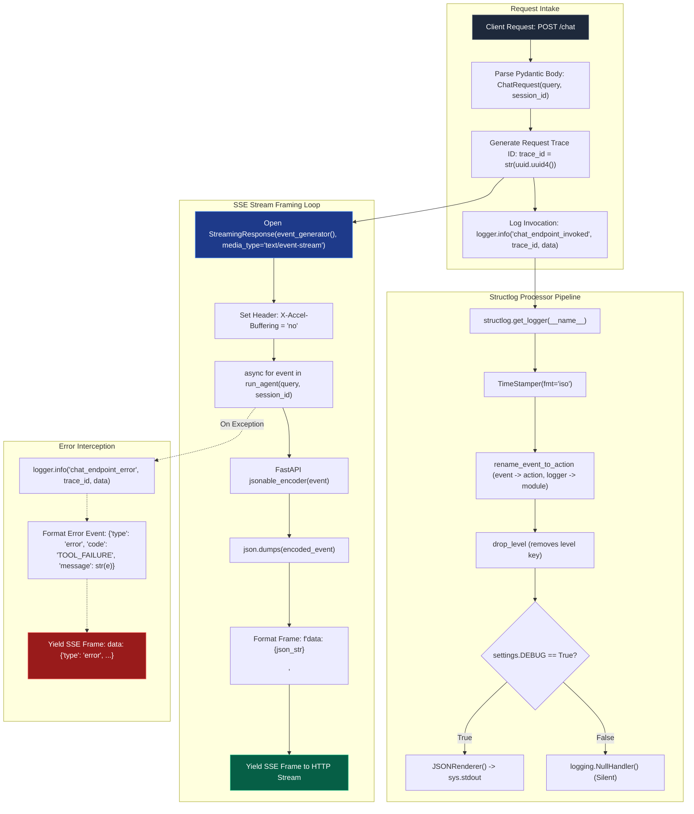

# FastAPI Service Module Architecture

---

## 🔀 FastAPI SSE Streaming & Structlog Logging Subsystem Flow Diagram

---

## 📖 Data Processing Pipeline Narrative

- **Request Handling & Middleware Stage:**
  - FastAPI handles CORS headers and parses request bodies using the `ChatRequest` schema.
  - Generates a unique request `trace_id` for end-to-end tracing.

- **Streaming & Encoding Stage:**
  - Invokes `run_agent` async generator and encodes yielded payloads via `jsonable_encoder`.
  - Packages events into standard SSE data frames (`data: <JSON>\n\n`) and streams them with unbuffered headers (`X-Accel-Buffering: no`).

- **Structured Logging Stage:**
  - `structlog` pipeline attaches ISO-8601 UTC timestamps, renames fields, strips levels, and writes single-line JSON logs to `sys.stdout` when `DEBUG=true`.
