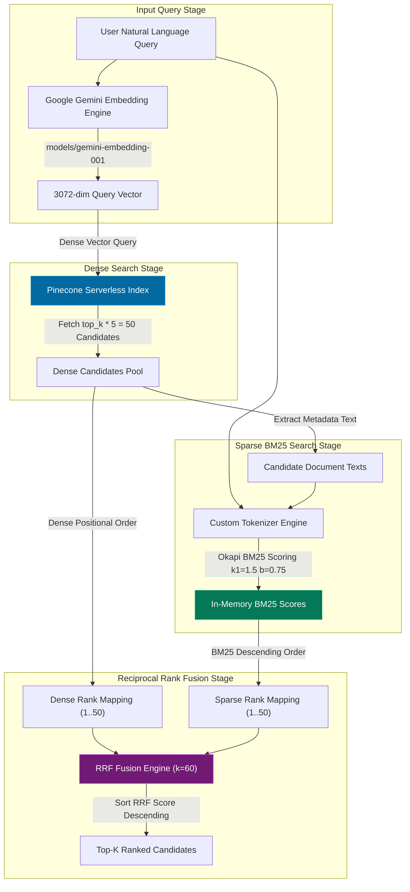
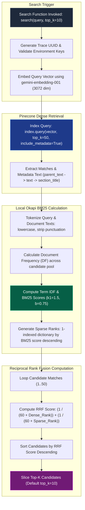

# Hybrid Search Module Architecture

---

## 🔀 BM25 Tokenization & RRF Rank Fusion Subsystem Flow Diagram

---

## 📖 Data Processing Pipeline Narrative

- **Dense Vector Search Path:**
  - User query string is converted to a 3072-dimensional vector embedding.
  - Pinecone vector database executes dense cosine distance retrieval, returning 50 top vector candidates.

- **Sparse BM25 Keyword Search Path:**
  - Candidate document texts are extracted from metadata dictionaries.
  - Custom tokenizer cleans punctuation and computes term frequency and inverse document frequency across the candidate pool.

- **Reciprocal Rank Fusion Path:**
  - Dense and sparse positional ranks are mapped onto a 1-indexed scale.
  - Reciprocal Rank Fusion formula calculates combined score using constant $k=60$.
  - Candidates are sorted by final RRF score and sliced to return top-10 candidate chunks.
