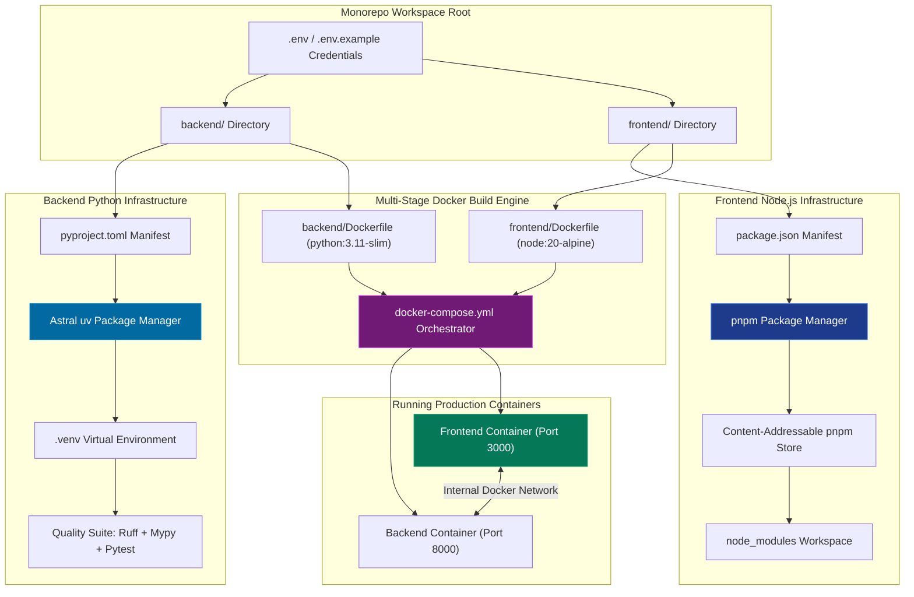

# Infrastructure Module Architecture



---

## 🔀 Multi-Stage Docker Container Building & Orchestration Subsystem Flow Diagram

```mermaid
flowchart TD
    subgraph Docker Compose Invocation
        C0["docker compose up -d --build"] --> C1["Read docker-compose.yml configuration"]
        C1 --> C2["Spawn Backend Build Thread"]
        C1 --> C3["Spawn Frontend Build Thread"]
    end

    subgraph Backend Multi-Stage Docker Pipeline
        C2 --> B1["Stage 1 (builder): FROM python:3.11-slim"]
        B1 --> B2["Install Astral uv via curl"]
        B2 --> B3["COPY pyproject.toml & RUN uv sync --no-dev"]
        B3 --> B4["Stage 2 (runner): FROM python:3.11-slim"]
        B4 --> B5["COPY --from=builder /app/.venv /app/.venv"]
        B5 --> B6["CMD ['uvicorn', 'app.main:app', '--host', '0.0.0.0', '--port', '8000']"]
    end

    subgraph Frontend Multi-Stage Docker Pipeline
        C3 --> F1["Stage 1 (deps): FROM node:20-alpine + pnpm install"]
        F1 --> F2["Stage 2 (builder): pnpm build (output: 'standalone')"]
        F2 --> F3["Stage 3 (runner): FROM node:20-alpine"]
        F3 --> F4["COPY --from=builder /app/.next/standalone ./"]
        F4 --> F5["CMD ['node', 'server.js']"]
    end

    subgraph Network Bridge & Container Execution
        B6 --> N1["Start Backend Service Container (0.0.0.0:8000)"]
        F5 --> N2["Start Frontend Service Container (0.0.0.0:3000)"]
        N1 <-->|Docker Bridge Network (backend_url)| N2
    end

    style C0 fill:#1e293b,stroke:#475569,color:#fff
    style B3 fill:#1e3a8a,stroke:#3b82f6,color:#fff
    style F2 fill:#701a75,stroke:#d946ef,color:#fff
    style N2 fill:#065f46,stroke:#10b981,color:#fff
```

---

## 📖 Data Processing Pipeline Narrative

- **Workspace Synchronization Stage:**
  - `uv` syncs Python backend dependencies into `.venv` using Rust resolution.
  - `pnpm` hard-links Node.js frontend dependencies into `node_modules`.

- **Quality Assurance Stage:**
  - `ruff` checks code formatting, `mypy` enforces static typing, and `pytest` runs automated test suites.

- **Container Packaging & Orchestration Stage:**
  - Multi-stage Dockerfiles build slim runtime images for backend (`python:3.11-slim`) and frontend (`node:20-alpine` with Next.js standalone).
  - `docker-compose` links both services on an isolated internal network (`backend:8000` $\leftrightarrow$ `frontend:3000`).
