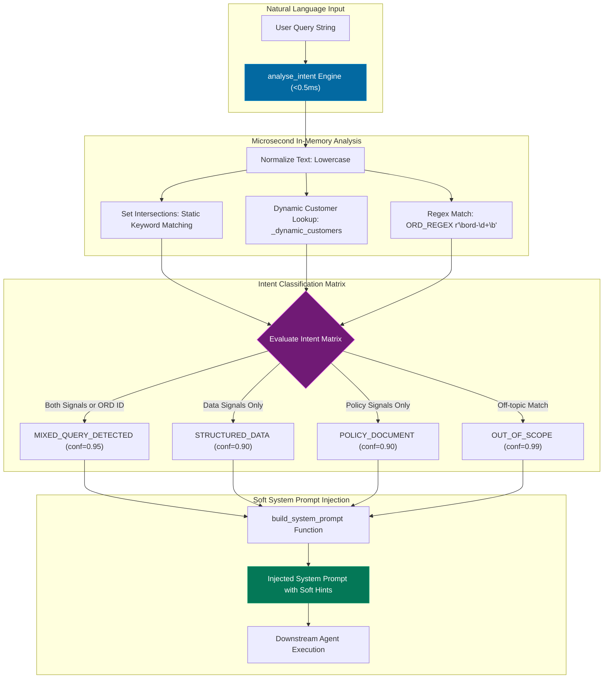
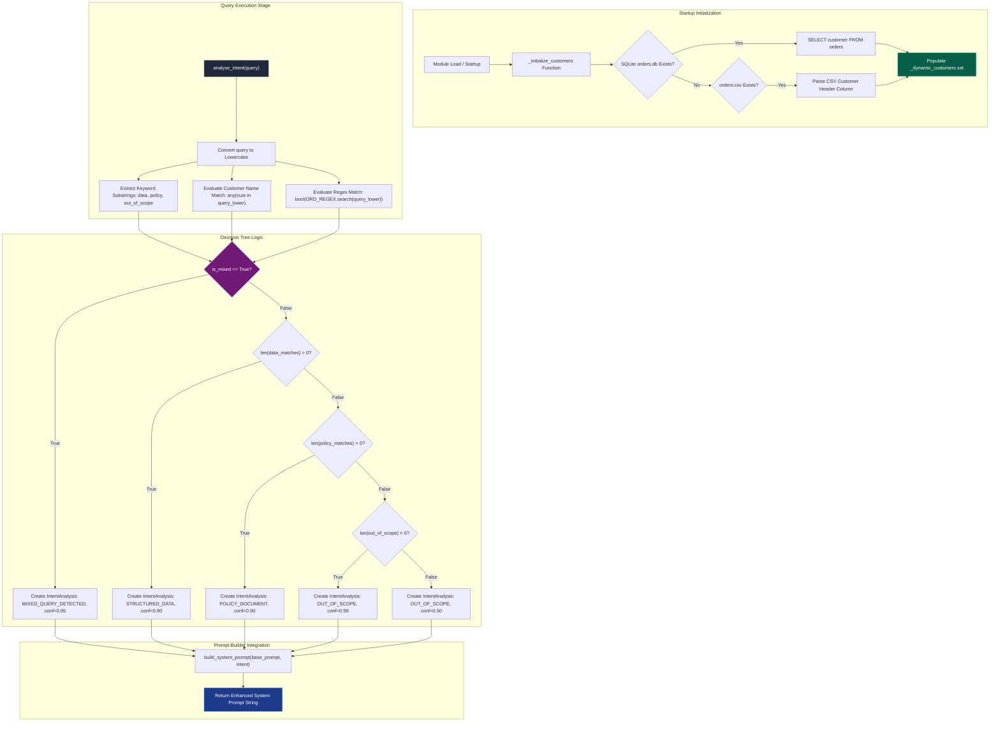

# Intent Router Module Architecture

---

## 🔀 Dynamic Customer Lookup & Intent Analysis Subsystem Flow Diagram

---

## 📖 Data Processing Pipeline Narrative

- **Dynamic Startup Phase:**
  - `orders.db` (or `orders.csv` fallback) is read at startup to extract unique customer full names into `_dynamic_customers`.

- **Intent Analysis Phase:**
  - Query string is lowercased and matched against static keyword sets, dynamic customer sets, and `ORD_REGEX` patterns.
  - Returns `IntentAnalysis` data object with labels, actionable hint text, and confidence score in <0.5ms.

- **System Prompt Injection Phase:**
  - `build_system_prompt` formats soft hint blocks and appends them to the base agent system prompt.
  - The downstream agent uses enriched prompt context to make autonomous tool choices.
