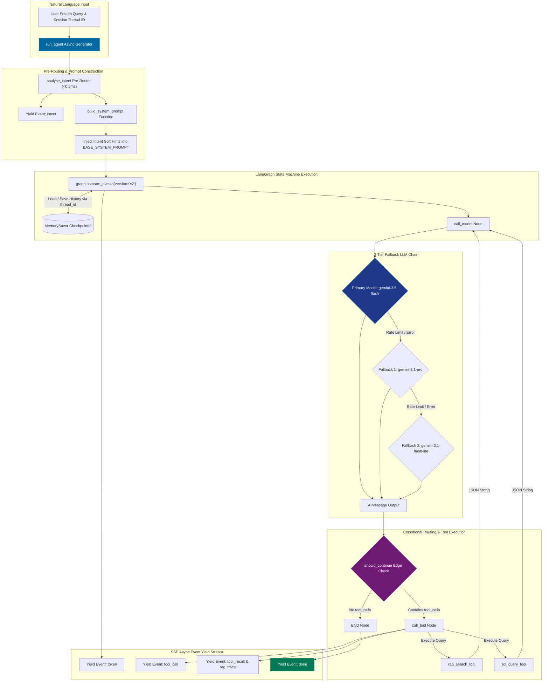
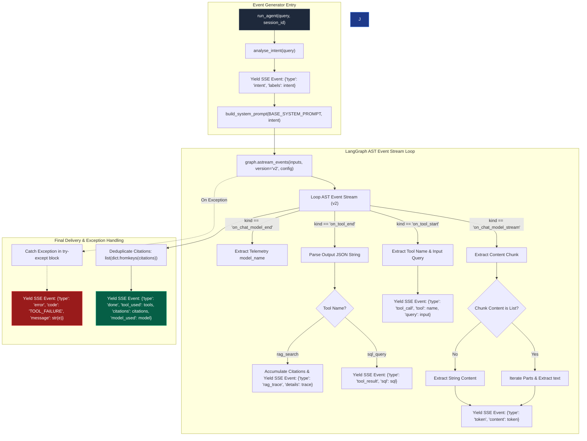

# LangChain Agent Module Architecture

---

## 🔀 LangGraph StateMachine & SSE Event Streaming Subsystem Flow Diagram

---

## 📖 Data Processing Pipeline Narrative

- **Pre-Routing & Prompt Stage:**
  - Intent router classifies query in <0.5ms and yields an `intent` SSE event.
  - Soft prompt hints are appended to `BASE_SYSTEM_PROMPT` for the current execution turn.

- **State Graph & Fallback LLM Stage:**
  - LangGraph executes `call_model`, using the 3-tier fallback LLM chain (`gemini-3.5-flash` $\rightarrow$ `gemini-3.1-pro` $\rightarrow$ `gemini-3.1-flash-lite`).
  - `should_continue` routes to node `tools` if tool calls are requested, returning `ToolMessage` outputs back to `agent`.

- **Event Streaming Stage:**
  - `run_agent` listens to AST stream events (`v2`), yielding `token`, `tool_call`, `tool_result`, `rag_trace`, and `done` events in real-time.