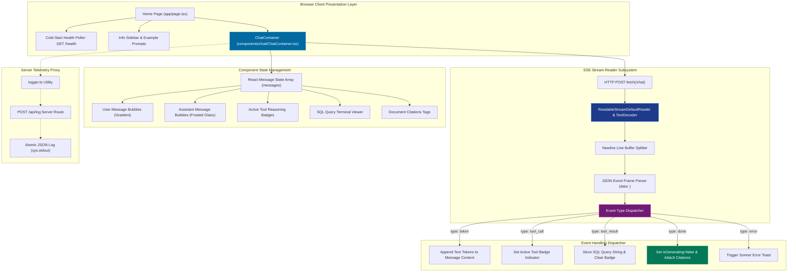
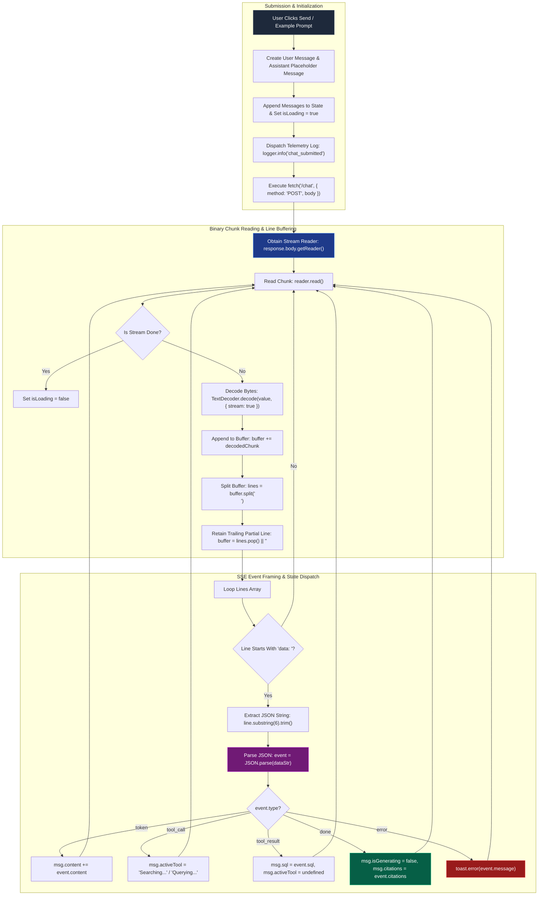

# Next.js UI Module Architecture

---

## 🔀 Next.js SSE Stream Reader & State Management Subsystem Flow Diagram

---

## 📖 Data Processing Pipeline Narrative

- **Submission Stage:**
  - `ChatContainer` creates user and assistant placeholder messages, updates state, logs submission telemetry via `/api/log`, and issues `POST /chat`.

- **Stream Reader & Buffer Stage:**
  - Binary UTF-8 chunks are read asynchronously, accumulated into a string buffer, and split by `\n`.
  - Trailing unparsed partial lines are retained in the buffer to prevent JSON syntax errors across TCP packet boundaries.

- **State Dispatch Stage:**
  - Parsed SSE event frames update assistant message state attributes (`content`, `activeTool`, `sql`, `citations`, `isGenerating`).
  - React components re-render automatically, and `scrollIntoView` smooth-scrolls the chat viewport.
