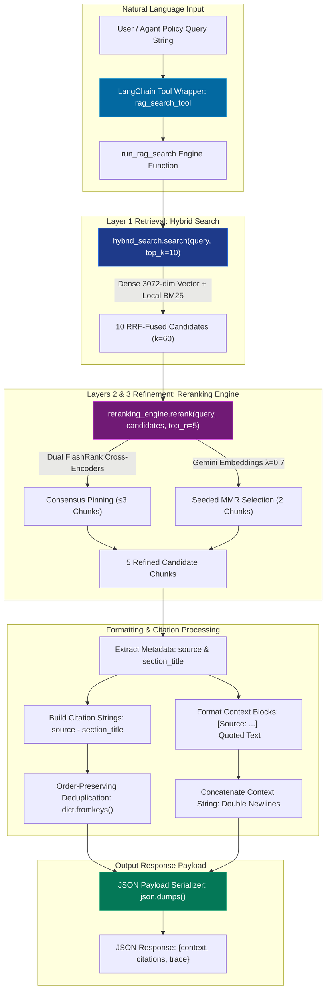

# RAG Tool Module Architecture



---

## 🔀 Context Formatting & Citation Deduplication Subsystem Flow Diagram

```mermaid
flowchart TD
    subgraph Execution Initiation
        S0["run_rag_search(query)"] --> S1["Log Initiation: atomic_log('run_rag_search_start')"]
        S1 --> S2["Initialize Telemetry Trace Dictionary: trace_data = {}"]
    end

    subgraph Two-Tier Retrieval Orchestration
        S2 --> H1["Invoke Layer 1: hybrid_search.search(query, top_k=10, trace=trace_data)"]
        H1 --> H2["Receive 10 RRF-Fused Candidates"]
        H2 --> R1["Invoke Layers 2 & 3: reranking_engine.rerank(query, candidates, top_n=5, trace=trace_data)"]
        R1 --> R2["Receive 5 Refined Pristine Chunks"]
    end

    subgraph Context & Citation Generation Loop
        R2 --> L0["Loop Chunk Objects (1..5)"]
        L0 --> L1["Extract source (default: 'unknown.pdf') & section_title (default: 'Unknown Section')"]
        L1 --> L2["Format Citation String: f'{source} - {section}'"]
        L2 --> L3["Append to citations accumulator list"]
        L3 --> L4["Format Text Block: f'[Source: {citation}]\n\"{text}\"'"]
        L4 --> L5["Append to context_blocks accumulator list"]
    end

    subgraph Final Assembly & Exception Isolation
        L5 --> A1["Join Context String: '\n\n'.join(context_blocks)"]
        A1 --> A2["Deduplicate Citations: list(dict.fromkeys(citations))"]
        A2 --> A3["Serialize Output: json.dumps({context, citations, trace})"]
        
        S2 -.->|On ImportError / Exception| E1["Catch Exception in try-except block"]
        E1 -.-> E2["Log Error: atomic_log('run_rag_search_error')"]
        E2 -.-> E3["Serialize Error Payload: json.dumps({'error': str(e)})"]
    end

    style S0 fill:#1e293b,stroke:#475569,color:#fff
    style H1 fill:#1e3a8a,stroke:#3b82f6,color:#fff
    style R1 fill:#701a75,stroke:#d946ef,color:#fff
    style A3 fill:#065f46,stroke:#10b981,color:#fff
    style E3 fill:#991b1b,stroke:#ef4444,color:#fff
```

---

## 📖 Data Processing Pipeline Narrative

- **Retrieval Pipeline Path:**
  - Query string is passed through `hybrid_search` (Dense vector + Sparse BM25 fused with RRF $k=60$) fetching 10 candidates.
  - Candidates are refined by `reranking_engine` (Dual FlashRank consensus + Seeded MMR $\lambda=0.7$) selecting 5 pristine chunks.

- **Formatting & Citation Path:**
  - Chunk metadata is extracted to build standardized citation strings (`source - section_title`).
  - Text passages are wrapped in quoted context blocks and concatenated using double newlines.
  - Duplicate citations are stripped using `dict.fromkeys()` preserving original rank order.
  - Output is serialized into a JSON string payload.
