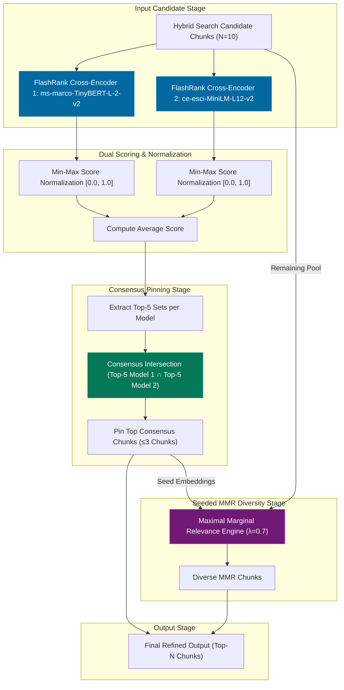
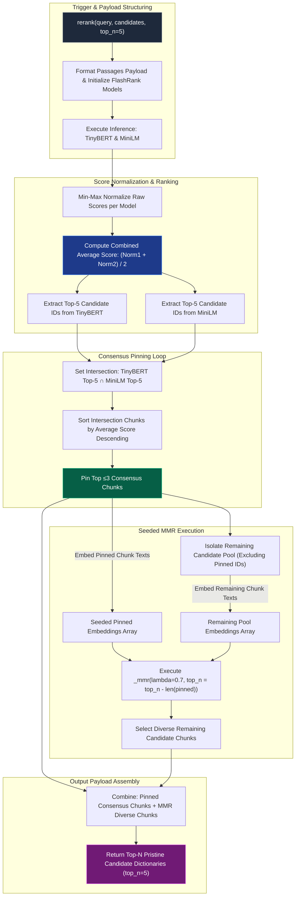

# Reranking Engine Module Architecture

---

## 🔀 Dual Cross-Encoder Consensus & Seeded MMR Subsystem Flow Diagram

---

## 📖 Data Processing Pipeline Narrative

- **Dual Cross-Encoder Scoring Path:**
  - Hybrid search candidate chunks are scored in parallel by `ms-marco-TinyBERT-L-2-v2` and `ce-esci-MiniLM-L12-v2`.
  - Raw scores are Min-Max normalized onto $[0.0, 1.0]$ and averaged.

- **Consensus Pinning Path:**
  - Candidates present in both top-5 sets are intersected and sorted by average score.
  - Up to 3 top consensus chunks are pinned directly to the output head.

- **Seeded MMR Diversity Path:**
  - Remaining candidate chunks are evaluated using Maximal Marginal Relevance ($\lambda=0.7$).
  - Vector embeddings of pinned chunks seed the MMR algorithm, penalizing candidates semantically redundant with pinned context.
  - The merged top-5 result set is returned.
