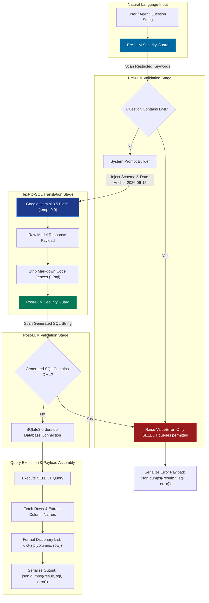
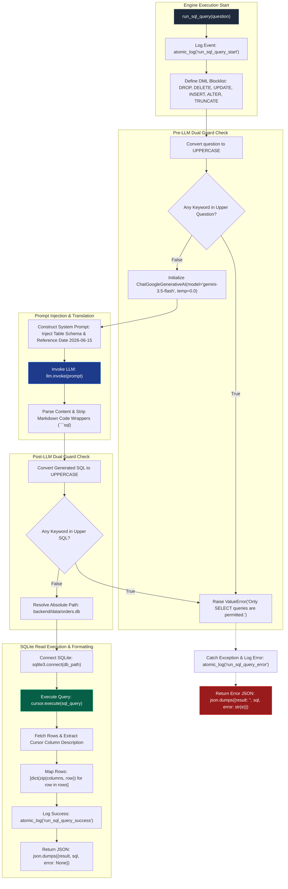

# SQL Tool Module Architecture

---

## 🔀 Dual DML Security Guard & SQL Translation Subsystem Flow Diagram

---

## 📖 Data Processing Pipeline Narrative

- **Dual Security Guard Path:**
  - Input question text is scanned for restricted DML keywords before calling LLM API.
  - Generated SQL text is re-scanned for restricted DML keywords before executing database query.
  - Any security violation short-circuits execution into a clean JSON error response.

- **Translation & Read-Only Execution Path:**
  - System prompt injects exact table schema (`orders`) and anchor date (`2026-06-15`).
  - Gemini 3.5 Flash generates read-only `SELECT` query with zero temperature.
  - SQLite database executes query, extracts column headers, and formats rows into key-value dictionaries.
